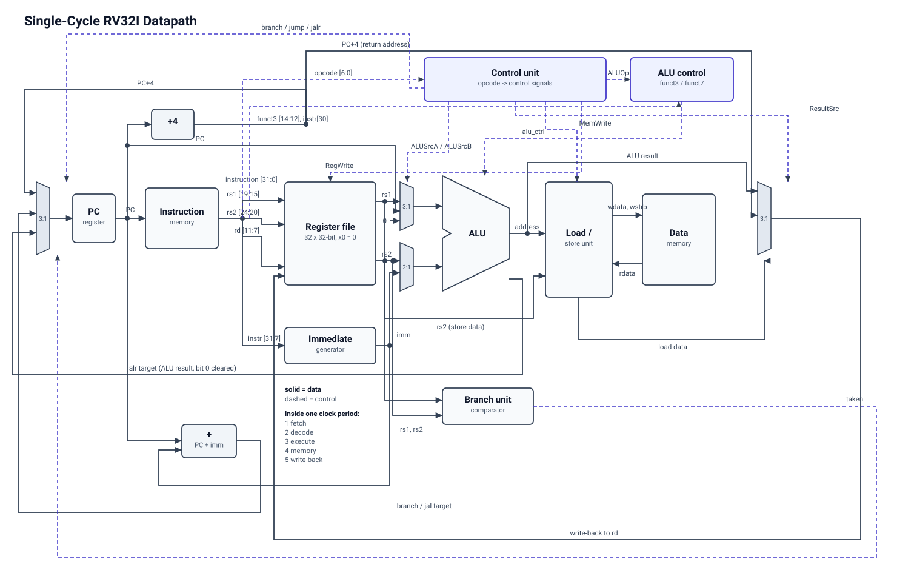

# Single-Cycle RISC-V Processor (RV32I) in Verilog

A complete, verified single-cycle implementation of the RV32I base integer
instruction set, written in Verilog-2001, with a self-checking testbench suite,
its own assembler, a reference instruction-set simulator, and a clean Yosys
synthesis flow.

Every instruction executes in exactly one clock cycle, so CPI = 1 by
construction — the test logs show instruction count equal to cycle count for
all seven programs.

---

## Status

| Check | Result |
|---|---|
| Module testbenches | 8 benches, 181 assertions, all pass |
| Whole-processor tests | 7 programs, register file + data memory match the reference model |
| Instruction coverage | 37 of 37 implemented instructions retired; all 6 branches taken *and* not taken (`make coverage`) |
| `iverilog -Wall` elaboration | clean |
| `verilator --lint-only -Wall` | clean |
| Yosys `check -assert` | 0 problems, no inferred latches |
| Area (generic gates) | 6150 cells, 1024 flip-flops |



Regenerate the diagram with `python3 tools/make_datapath_svg.py`.

---

## Layout

```
src/                 the processor
  riscv_defs.vh      all shared constants and control encodings
  alu.v              32-bit arithmetic / logic unit
  alu_control.v      second-level decoder: ALUOp + funct3 + funct7 -> ALU opcode
  control_unit.v     main decoder: opcode -> control signals
  reg_file.v         32 x 32-bit, 2 read ports, 1 write port, x0 hard-wired to 0
  imm_gen.v          immediate extraction and sign extension (I/S/B/U/J)
  branch_unit.v      branch condition comparator
  lsu.v              load/store alignment, byte strobes, sign/zero extension
  pc.v               program counter register
  instr_mem.v        instruction memory, asynchronous read
  data_mem.v         data memory, asynchronous read, byte-enabled write
  riscv_core.v       datapath + control, no memories (this is the synthesis target)
  riscv_top.v        core + both memories (this is what the testbench runs)

tb/                  self-checking testbenches, one per module plus the top
tools/
  asm.py             RISC-V assembler for the supported subset
  iss.py             reference instruction-set simulator (the golden model)
  check_asm.sh       cross-checks asm.py against the GNU RISC-V assembler
programs/            test and demo programs in assembly
synth/synth.ys       Yosys synthesis script
build/               generated: .hex, .lst, .vcd, netlist, reports
docs/                diagrams
```

---

## Requirements

```bash
sudo apt install iverilog gtkwave yosys verilator
# optional, only for tools/check_asm.sh:
sudo apt install binutils-riscv64-unknown-elf
```

Nothing else. No Vivado needed unless you want a vendor RTL schematic or a
board bitstream.

---

## Running it

```bash
make                    # assemble all programs, run every test, report
make modules            # only the per-module testbenches
make programs           # only assemble (.hex, .data.hex, .lst)
make run PROG=fib       # run one program on the RTL
make trace PROG=gcd     # same, printing every instruction as it retires
make wave PROG=fib      # open the waveform in GTKWave
make lint               # iverilog + verilator structural checks
make synth              # Yosys synthesis, area report, netlist
make clean
```

### Writing your own program

```bash
cat > programs/mine.s <<'ASM'
    .text
    li   t0, 6                # multiplicand
    li   t1, 7                # counter
    li   a0, 0                # accumulator
mul_loop:                     # RV32I has no mul, so add in a loop
    add  a0, a0, t0
    addi t1, t1, -1
    bnez t1, mul_loop         # a0 = 6 * 7 = 42
halt:
    j    halt
ASM
python3 tools/asm.py programs/mine.s -o build/mine   # .hex + .lst
python3 tools/iss.py build/mine                      # expected end state
make run PROG=mine
```

Add the name to `PROGRAMS` in the Makefile and `make` will pick it up.

---

## Implemented instructions (37)

| Class | Instructions |
|---|---|
| Register-register | `add` `sub` `sll` `slt` `sltu` `xor` `srl` `sra` `or` `and` |
| Register-immediate | `addi` `slti` `sltiu` `xori` `ori` `andi` `slli` `srli` `srai` |
| Loads | `lb` `lh` `lw` `lbu` `lhu` |
| Stores | `sb` `sh` `sw` |
| Branches | `beq` `bne` `blt` `bge` `bltu` `bgeu` |
| Jumps | `jal` `jalr` |
| Upper immediate | `lui` `auipc` |

That is all of RV32I except `fence`, `ecall` and `ebreak`, which need a
privileged mode and an exception mechanism this core does not have. Any
unimplemented opcode decodes as an inert NOP and raises `dbg_illegal`.

The assembler also accepts the usual pseudo-instructions: `nop` `li` `la` `mv`
`not` `neg` `seqz` `snez` `sltz` `sgtz` `j` `jr` `call` `ret` `beqz` `bnez`
`blez` `bgez` `bltz` `bgtz` `bgt` `ble` `bgtu` `bleu`.

---

## How verification works

Three independent layers, so a mistake has to survive all three to reach the
final result:

1. **Module testbenches.** Each block is driven against hand-written expected
   values, including the boundary cases that break careless implementations:
   `slt` vs `sltu` with negative numbers, shift amounts above 31, `srai` vs
   `srli`, every byte lane of `lb`/`lbu`, the most negative immediate in every
   instruction format.

2. **A reference simulator** (`tools/iss.py`), written in Python straight from
   the RISC-V spec, sharing no code with the Verilog. It runs the same `.hex`
   image and records the expected final register file and memory. The top-level
   testbench compares the RTL against that record — the RTL is never compared
   against itself.

3. **An independent encoding oracle.** `tools/check_asm.sh` assembles a
   coverage file with both `asm.py` and the GNU RISC-V assembler and diffs the
   machine code word for word (84/84 identical, covering every instruction,
   both immediate extremes of every format, forward and backward branches, and
   every multi-word `li` expansion). So if the assembler were wrong, the tests
   would be running the wrong program — and this catches that.

Programs also carry their own internal checks: `test_branch.s` and
`test_jump.s` keep a pass counter and jump to a `fail` label on any wrong
outcome, so a failure is visible even without the reference model.

---

## Synthesis

```bash
make synth
```

`riscv_core` is the synthesis target, not `riscv_top`: the memories belong to
the platform (block RAM on an FPGA), not to the processor. Results from
Yosys 0.33, mapped to simple AND/OR/XOR/NOT/MUX gates:

| | Count |
|---|---|
| Total cells | 6150 |
| Flip-flops | 1024 |
| MUX | 2287 |
| AND | 1342 |
| OR | 1086 |
| NOT | 214 |
| XOR | 197 |

The flip-flop count is worth checking by hand, because it confirms the design
is right: 31 writable registers x 32 bits = 992, plus 32 bits of program
counter = 1024. `x0` costs nothing at all — the synthesiser proved it away,
exactly as a hard-wired zero register should.

### On an FPGA

The memories read asynchronously, which a single-cycle design requires: the
instruction must be fetched, decoded, executed and written back inside one
clock period, so a fetch cannot wait for a clock edge. FPGA block RAM has a
registered output and will not do this. Keep both memories small so they map to
distributed (LUT) RAM, or move to a multi-cycle or pipelined design.

---

## Known limitations

These are deliberate scope choices, not defects:

- **No pipelining.** The clock period must cover the whole
  fetch-decode-execute-memory-writeback chain, so the maximum frequency is low.
  This is the fundamental trade-off of single-cycle design, and the natural
  next step for this project is a 5-stage pipeline with forwarding.
- **No exceptions, traps or CSRs**, hence no `ecall`/`ebreak`.
- **Misaligned accesses are flagged, not trapped.** `dbg_misaligned` goes high
  and the access proceeds against the addressed word; real RISC-V either
  supports them or traps.
- **Harvard memories.** Instructions and data live in separate address spaces,
  both starting at 0. Self-modifying code is impossible, which is fine.
- **No `mul`/`div`** — those are the M extension, not base RV32I.

## Note on a harmless simulation warning

`$readmemh` prints *"Not enough words in the file for the requested range"*
whenever a program is shorter than the memory. The memories zero-fill
themselves before loading, so unwritten locations read as 0 and the warning has
no effect. The Makefile filters it out of the test logs.

---

## References

- *The RISC-V Instruction Set Manual, Volume I: Unprivileged ISA* — the
  authority on every encoding in `riscv_defs.vh`.
- Harris & Harris, *Digital Design and Computer Architecture, RISC-V Edition* —
  the single-cycle datapath this design follows, with the control signals
  renamed for clarity.
